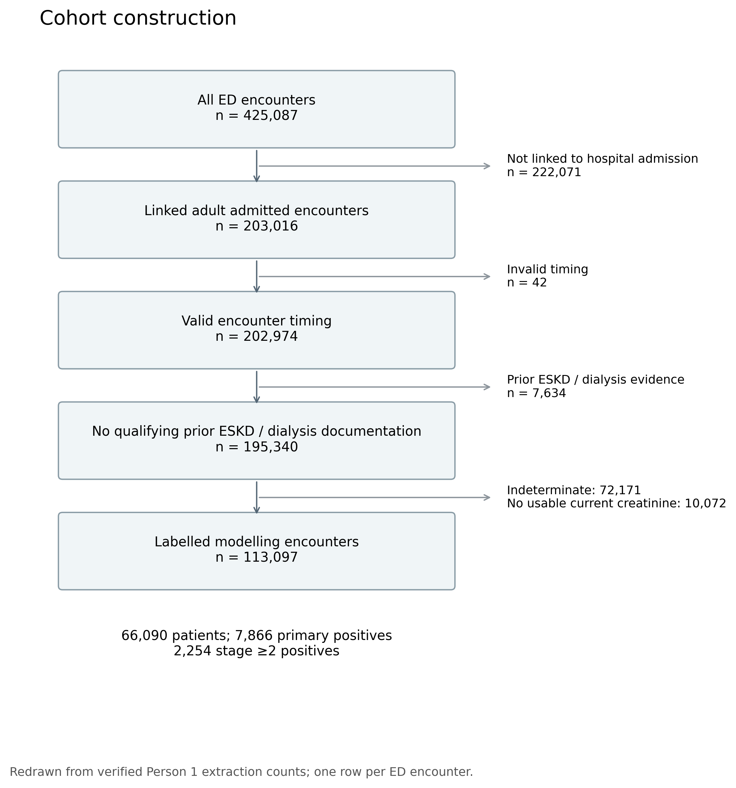
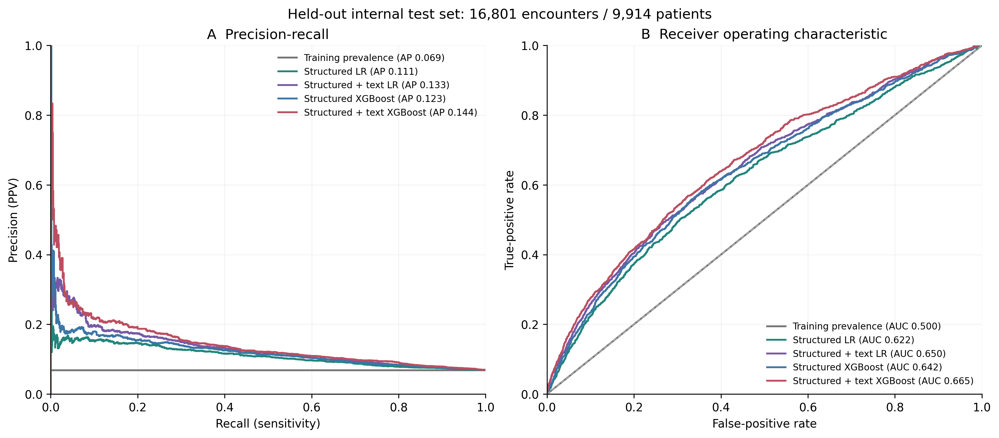
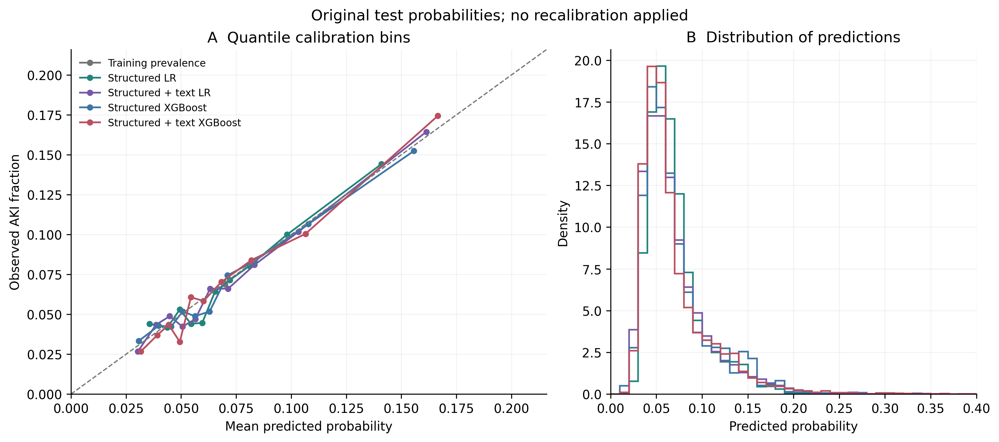
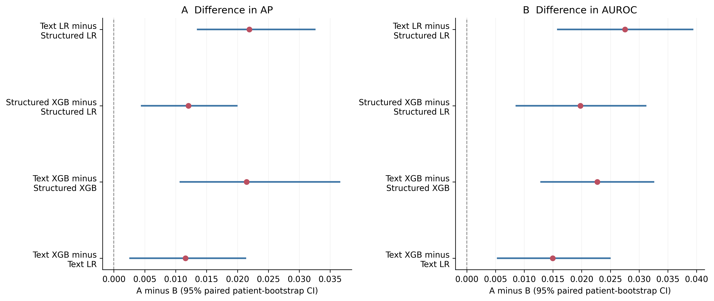
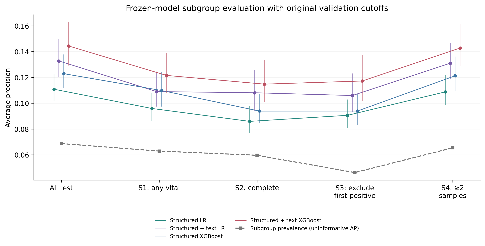
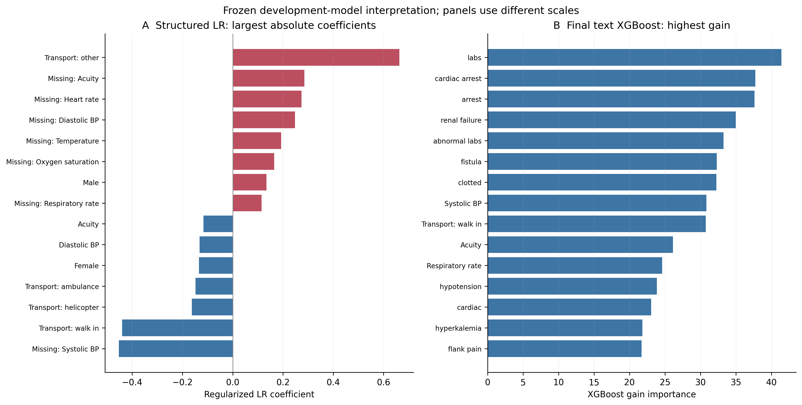
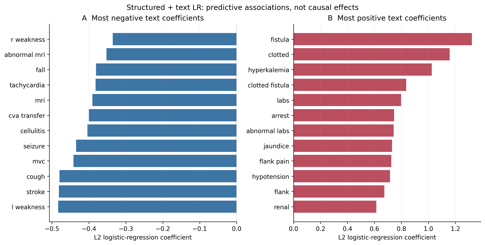

# Early identification of observed creatinine-defined AKI at ED admission

Public repository copy: patient-level data, predictions, fitted artifacts and bootstrap caches are omitted. Results were generated in the authorised local environment; full reproduction requires the private team handoffs.

COMP90089 Group 7 report draft · Person 5 integration · 19 October 2026

## 1 Background and study objective

This retrospective study assessed whether information available at emergency department (ED) admission could identify observed creatinine-defined acute kidney injury (AKI) within 24 hours of ED arrival or earlier hospital discharge. The population comprised adults subsequently admitted to hospital with an outcome-assessable encounter. The prediction anchor is described consistently as **at ED admission**; follow-up starts at the recorded ED arrival time. The study includes cases already positive at the first current sample and therefore concerns early identification rather than exclusively incident, previously unsuspected AKI.

The comparison was designed to separate the information gained from richer predictors from differences between modelling approaches: prevalence and age/gender baselines, structured logistic regression (LR), structured-plus-chief-complaint LR, and corresponding XGBoost predictor groups. Person 5 evaluated the seven existing training-fitted models with a common protocol. No additional model development was conducted for this evaluation.

## 2 Data sources and cohort

Person 1 extracted MIMIC-IV-ED and MIMIC-IV Hospital v2.2 data through the authorised BigQuery/Colab workflow. Python performed linkage, cohort selection, predictor cleaning and outcome derivation. The analysis unit was an ED encounter identified by `stay_id`; `subject_id` identified patients with potentially repeated encounters. Adult, hospital-admitted encounters with valid timing were retained, excluding evidence of prior ESKD or chronic dialysis from a different admission discharged before ED arrival. Other chronic kidney disease was retained.

The cohort decreased from 425,087 ED encounters to 203,016 linked admitted encounters, 202,974 encounters after excluding 42 timing errors, and 195,340 eligible encounters after excluding 7,634 with qualifying renal-history evidence. Of these, 113,097 encounters from 66,090 patients were labelled: 7,866 primary positives and 105,231 operational negatives. Another 72,171 were indeterminate and 10,072 had no usable current creatinine. The labelled primary positivity of 6.96% is not an estimate for all admitted ED encounters.

Figure 1 was redrawn from the verified extraction counts. An independently supplied, mentor-approved waterfall image was not present in the reviewed folder.

## 3 Outcome, descriptive findings and preprocessing

### 3.1 Creatinine-only operational phenotype

The observation window extended from ED arrival to the earlier of arrival plus 24 hours or hospital discharge. Chemistry creatinine items 50912 and 52546 were used; whole-blood item 52024 was excluded from the primary definition. Usable results were positive values no greater than 150 mg/dL, a broad extraction screen. Conflicting patient/sample-time values were removed; a shared event was assigned to the most recent eligible ED arrival, breaking exact ties by smaller stay ID.

A positive outcome required an observed rise of at least 0.3 mg/dL relative to the minimum strictly earlier usable result within 48 hours, or at least 1.5 times the minimum earlier result within seven days. Boundary times were included and Decimal arithmetic preserved threshold comparisons. References could precede arrival. Operational negatives required at least two distinct current sample times, a timed comparison, and no observed qualifying rise. Neither baseline creatinine nor outcomes were imputed. Operational negatives indicate no qualifying rise observed in available samples, not established clinical absence of AKI.

The secondary label was observed creatinine stage >=2 in the same primary labelled population: 2,254 encounters. Stage 1 and operational negatives were zero for this secondary label. Urine output and renal replacement therapy were not included. No stage >=2-specific fitted models were supplied, so the present seven-model evaluation addresses only the primary outcome.

### 3.2 Independent review and descriptive results

Person 2's independent review passed 30 count reconciliations, 41 row-level rule checks with zero violations, independent cleaning reproduction with zero differing rows across 13 predictors, and 26 synthetic boundary cases. Source laboratory rows were not included in the local handoff, so this comprised exported-data checks, code review and synthetic cases rather than a fresh source-database phenotype extraction.

| Characteristic | Operational negative (105,231) | Primary positive (7,866) | SMD |
| --- | --- | --- | --- |
| Age, years: median [IQR] | 66.0 [52.0–78.0] | 66.0 [55.0–78.0] | 0.069 |
| Gender: M | 52,223 (49.6%) | 4,401 (55.9%) | 0.127 |
| Arrival transport: AMBULANCE | 53,091 (50.5%) | 4,515 (57.4%) | 0.140 |
| Temperature, °F: missing | 10,387 (9.9%) | 1,522 (19.3%) | 0.271 |
| Systolic BP, mmHg: median [IQR] | 132.0 [117.0–149.0] | 127.0 [110.0–148.0] | -0.139 |
| Diastolic BP, mmHg: median [IQR] | 74.0 [64.0–85.0] | 71.0 [60.0–83.0] | -0.166 |
| Triage acuity (ESI): 1 | 12,577 (12.0%) | 1,510 (19.2%) | 0.201 |
| All six vital signs missing: Yes | 7,630 (7.3%) | 1,193 (15.2%) | 0.253 |

Missingness differed by outcome: six vital signs were all missing in 15.2% of positives versus 7.3% of operational negatives. AKI frequency was 13.5% among encounters missing all six vitals versus 6.4% with at least one vital recorded, supporting explicit missingness indicators for LR. The labelled cohort was older and had longer hospital stays than excluded encounters: median ages 66, 55 and 52 years and hospital stays 3.7, 1.1 and 0.4 days in labelled, indeterminate and no-creatinine groups, respectively.

Ascertainment also differed. Positives had a median three current samples versus two among negatives; the last negative sample preceded the window endpoint by a median 7.5 hours. Among 7,866 positives, 2,627 (33.4%) were positive at their first current sample, 725 (9.2%) were initially assessable without a rise and later positive, and 4,514 (57.4%) were initially unassessable and later positive. The first-positive sample time is an ascertainment time, not necessarily biological onset. Detailed characteristics, missingness, selection and sampling tables remain in Person 2's `outputs/table1_...` through `table5_...` CSV files and `P2_tables.xlsx`.

### 3.3 Patient-separated development and test partitions

Person 2 fixed a single 70/15/15 patient-level split, stratifying on the worst observed patient outcome (none, stage 1 only, stage >=2) with seed 90089. Training contained 79,364 encounters / 46,263 patients / 5,546 positives; validation contained 16,932 / 9,913 / 1,165; testing contained 16,801 / 9,914 / 1,155. Every patient's encounters stayed together. Person 5 verified encounter/subject alignment and zero patient overlap; no split was changed.

Thirteen cleaned inputs covered age, gender, arrival transport, six vital signs, acuity, numeric pain, pain-entry status and chief complaint. Identifiers, creatinine values, sampling fields and outcome-derived fields were excluded. P2 fitted preprocessing on training only. LR used training-median imputation, numeric standardisation, eight missingness indicators and categorical one-hot encoding, giving 27 structured columns. Tree models retained numeric NaN and used one-hot categoricals, giving 19 columns. Acuity was ordinal numeric. Chief complaints were lowercased and represented using training-fitted 1-2 gram TF-IDF, `min_df=5`, sublinear TF and a clinical shorthand-preserving tokenizer. The 2,772 terms yielded 2,799 LR or 2,791 tree columns.

## 4 Model development and unified evaluation

### 4.1 Frozen model development

P3 provided a training-prevalence constant, unpenalised age/gender LR, structured L2 LR and structured-plus-text L2 LR. The two regularised models independently selected C from 0.001, 0.01, 0.1, 1, 10 and 100 by validation AP; selected values were 10 and 0.1. LR used lbfgs and tolerance 1e-8. The text iteration limit was increased for convergence, without expanding the search. The models were training-fitted without resampling or class weighting.

P4 compared age/gender, structured and structured-plus-text XGBoost using binary logistic objective and histogram trees. A recorded nine-candidate search selected 400 trees, depth 3, learning rate 0.03 for the structured model. The same settings supported a predictor-group comparison. A separate nine-candidate text search selected 300 trees, depth 3, learning rate 0.05; row and column subsampling were 0.8. Model seed 42 was separate from split seed 90089. Validation selected settings; the test set did not drive model or predictor selection.

### 4.2 Inference adapters and structured-zero consistency

P3 joblib files contain raw-input preprocessing/classifier Pipelines, so P5 passed exactly the 13 cleaned raw columns. P4 files contain classifiers: age/gender used named columns `num__age` and `cat__gender_M` (current indices 0 and 10); structured XGBoost received the 19-column dense matrix. For text XGBoost, P5 reproduced P4's explicit-CSR reconstruction of the structured block, preserving zero and NaN entries, and joined the unchanged 2,772 TF-IDF columns. Passing the original sparse text matrix directly would change the structured-zero representation. This adapter reproduced validation predictions before test access. Sparse missing-value semantics are described in the [XGBoost FAQ](https://xgboost.readthedocs.io/en/stable/faq.html).

Execution used the existing `sml` environment: Python 3.12.11, scikit-learn 1.7.2 and XGBoost 3.1.2. Maximum validation probability differences were approximately 1.1e-16 for P3 and 2.1e-8 for P4. Structured LR exhibited a cross-platform tie-ranking effect: its handoff AP was 0.116995 versus local AP 0.117000 despite probability differences below 9e-17. Both original and reproduced validation metrics were retained; scores were not rounded or changed. Probability checks and a documented 1e-5 ranking-metric tolerance passed before testing. Upstream code and model files were unchanged.

### 4.3 Metrics, thresholds, calibration and uncertainty

Average precision (AP), computed as recall-increment-weighted precision rather than trapezoidal PR area, was the primary discrimination metric, with AUROC and Brier score supporting. The implementation was independently checked against scikit-learn's [AP](https://scikit-learn.org/1.7/modules/generated/sklearn.metrics.average_precision_score.html), AUROC and Brier functions, including tied scores and integer sample weights.

Before test evaluation, the user confirmed a target validation sensitivity of at least 0.80. For each model, the largest cutoff attaining that sensitivity was selected, including all ties under probability >= cutoff. These cutoffs, model artifacts, adapters, metric code and sensitivity definitions were recorded in `outputs/checks/analysis_freeze.json`. No test-based cutoff adjustment, refitting or recalibration occurred. Sensitivity, specificity, PPV, NPV, false-positive rate, fraction flagged and false positives per 1,000 encounters used the frozen cutoffs. The constant baseline flags every encounter at its qualifying cutoff, giving no useful graded operating point and undefined NPV.

Calibration used ten quantile bins, with ties retained. An unpenalised diagnostic logistic regression of outcome on logit predicted probability estimated joint intercept and slope; a separate offset-only fit with slope fixed at one estimated calibration-in-the-large. Ideal values are 0, 1 and 0, respectively. Probabilities were clipped to [1e-12, 1-1e-12] only for taking logits, without modifying reported scores. Joint slope/intercept are unidentifiable for the constant model and reported NA; its calibration-in-the-large remains defined. These are diagnostic fits, not probability recalibration. Definitions follow the [prediction-model evaluation methods literature](https://www.bmj.com/content/384/bmj-2023-074820).

Uncertainty used 1,000 nonparametric patient-cluster bootstrap replicates, seed 9008905. Each replicate sampled the same number of patients with replacement and included every encounter of each sampled patient with its multiplicity. All seven models shared the identical resample within each scope. Percentile 95% intervals were computed for primary test metrics, including calibration diagnostics where identifiable. Direct paired differences were calculated from the same replicates for four prespecified model contrasts; no p-values were calculated. Models, thresholds and preprocessing stayed fixed. Intervals therefore describe evaluation uncertainty conditional on the fitted models and validation-selected cutoffs, not uncertainty in the entire model-development process.

Sensitivity analyses evaluated frozen models at unchanged cutoffs in P2-defined S1 (at least one vital), S2 (complete predictor cases), S3 (excluding positives already positive at first sample) and S4 (at least two current samples for positives too). S1/S3/S4 were the recommended phenotype checks; S2 was supplementary. Each subgroup received its own patient-cluster bootstrap with shared resamples across models. Subgroup calibration has point estimates only. These outcome/sampling-derived restrictions are retrospective sensitivity checks, not proposed prospective eligibility rules.

## 5 Results

### 5.1 Held-out test discrimination and overall accuracy

The test set contained 16,801 encounters from 9,914 patients, including 1,155 positives (6.87%). These are held-out **internal** test results from the same source population, not external validation.

| Model | AP [95% CI] | AUROC [95% CI] | Brier [95% CI] |
| --- | --- | --- | --- |
| Training prevalence | 0.0687 [0.0647, 0.0726] | 0.5000 [0.5000, 0.5000] | 0.06402 [0.06052, 0.06737] |
| Age / gender LR | 0.0739 [0.0684, 0.0804] | 0.5331 [0.5154, 0.5500] | 0.06397 [0.06047, 0.06729] |
| Structured LR | 0.1109 [0.1020, 0.1227] | 0.6224 [0.6048, 0.6410] | 0.06311 [0.05959, 0.06637] |
| Structured + text LR | 0.1328 [0.1202, 0.1495] | 0.6499 [0.6326, 0.6686] | 0.06245 [0.05906, 0.06568] |
| Age / gender XGBoost | 0.0753 [0.0697, 0.0814] | 0.5393 [0.5212, 0.5563] | 0.06395 [0.06040, 0.06726] |
| Structured XGBoost | 0.1229 [0.1116, 0.1378] | 0.6422 [0.6240, 0.6604] | 0.06275 [0.05926, 0.06599] |
| Structured + text XGBoost | 0.1444 [0.1292, 0.1628] | 0.6649 [0.6477, 0.6820] | 0.06208 [0.05868, 0.06531] |

The highest observed test AP was 0.1444 for Structured + text XGBoost. The prespecified paired AP difference between text XGBoost and text LR was 0.01160, with 95% CI [0.00251, 0.02143]; the interval excluded zero. Model comparisons should be read from paired intervals rather than overlap between separate model intervals.

### 5.2 Operating characteristics at validation-selected cutoffs

| Model | Cutoff | Sensitivity | Specificity | PPV | NPV | Flagged | FP / 1,000 |
| --- | --- | --- | --- | --- | --- | --- | --- |
| Training prevalence | 0.069881 | 1.000 | 0.000 | 0.069 | NA | 1.000 | 931.3 |
| Age / gender LR | 0.060825 | 0.815 | 0.228 | 0.072 | 0.943 | 0.775 | 718.6 |
| Structured LR | 0.052481 | 0.791 | 0.317 | 0.079 | 0.954 | 0.690 | 635.7 |
| Structured + text LR | 0.051644 | 0.784 | 0.380 | 0.085 | 0.960 | 0.631 | 577.4 |
| Age / gender XGBoost | 0.061636 | 0.823 | 0.206 | 0.071 | 0.940 | 0.796 | 739.0 |
| Structured XGBoost | 0.049853 | 0.805 | 0.343 | 0.083 | 0.960 | 0.667 | 611.7 |
| Structured + text XGBoost | 0.050693 | 0.805 | 0.388 | 0.089 | 0.964 | 0.625 | 569.5 |

At the selected text-XGBoost cutoff, sensitivity was 80.52%, specificity 38.84%, PPV 8.86% and NPV 96.43%. It flagged 62.49% of encounters: 930 true-positive and 9,569 false-positive flags, with 225 missed observed positives. This is about 10.3 false-positive flags per true positive, a substantial workload despite the target sensitivity.

Cutoffs above are displayed to six decimals for readability; the CSV and frozen protocol retain full precision. Their selection guaranteed the validation sensitivity target, not a test sensitivity of exactly 0.80. `FP / 1,000` counts false-positive flags per 1,000 total test encounters, distinct from the false-positive rate among negatives. Confidence intervals for threshold metrics are in `outputs/tables/test_confidence_intervals.csv`.

### 5.3 Calibration

| Model | Joint intercept [95% CI] | Slope [95% CI] | Calibration-in-large [95% CI] |
| --- | --- | --- | --- |
| Training prevalence | NA | NA | -0.018 [-0.083, 0.042] |
| Age / gender LR | -0.581 [-1.565, 0.333] | 0.782 [0.400, 1.150] | -0.019 [-0.085, 0.041] |
| Structured LR | -0.008 [-0.349, 0.347] | 1.005 [0.871, 1.150] | -0.020 [-0.089, 0.042] |
| Structured + text LR | 0.028 [-0.233, 0.317] | 1.021 [0.920, 1.137] | -0.025 [-0.092, 0.036] |
| Age / gender XGBoost | -0.703 [-1.509, 0.119] | 0.735 [0.422, 1.059] | -0.022 [-0.088, 0.036] |
| Structured XGBoost | -0.068 [-0.354, 0.230] | 0.983 [0.869, 1.099] | -0.026 [-0.094, 0.035] |
| Structured + text XGBoost | 0.115 [-0.142, 0.367] | 1.056 [0.958, 1.157] | -0.023 [-0.090, 0.036] |

The plot shows original probabilities, without fitted recalibration. The observed Brier differences and calibration estimates should be interpreted together; a lower Brier score alone is not proof of clinically adequate calibration. Quantile-bin lines are descriptive and have no bin-level confidence bands; patient-bootstrap intervals for the global calibration diagnostics are tabulated.

### 5.4 Paired model comparisons

| Comparison | Metric | Difference | 95% paired CI |
| --- | --- | --- | --- |
| Structured + text LR minus Structured LR | average_precision | 0.02192 | [0.01342, 0.03263] |
| Structured + text LR minus Structured LR | auroc | 0.02752 | [0.01572, 0.03942] |
| Structured XGBoost minus Structured LR | average_precision | 0.01205 | [0.00439, 0.02001] |
| Structured XGBoost minus Structured LR | auroc | 0.01977 | [0.00849, 0.03128] |
| Structured + text XGBoost minus Structured XGBoost | average_precision | 0.02146 | [0.01064, 0.03666] |
| Structured + text XGBoost minus Structured XGBoost | auroc | 0.02273 | [0.01282, 0.03265] |
| Structured + text XGBoost minus Structured + text LR | average_precision | 0.01160 | [0.00251, 0.02143] |
| Structured + text XGBoost minus Structured + text LR | auroc | 0.01497 | [0.00524, 0.02504] |

Comparisons include text gain within LR, algorithm differences for structured inputs, text gain within XGBoost, and algorithm differences with text included. Numeric preprocessing remains algorithm-appropriate while patient partitions, outcomes and the text vocabulary are shared. The complete paired table also reports Brier-score differences; positive AP/AUROC differences favour the first model, whereas negative Brier differences favour the first model.

### 5.5 Sensitivity analyses

| Subset | Encounters | Positive n (%) | Text LR AP [95% CI] | Text XGBoost AP [95% CI] |
| --- | --- | --- | --- | --- |
| S1_has_any_vital | 15,499 | 975 (6.29%) | 0.1090 [0.0975, 0.1245] | 0.1216 [0.1081, 0.1391] |
| S2_complete_case | 13,355 | 797 (5.97%) | 0.1081 [0.0942, 0.1255] | 0.1148 [0.1009, 0.1332] |
| S3_excl_positive_at_first_sample | 16,405 | 759 (4.63%) | 0.1060 [0.0931, 0.1231] | 0.1172 [0.1019, 0.1375] |
| S4_two_or_more_samples | 16,742 | 1,096 (6.55%) | 0.1310 [0.1186, 0.1470] | 0.1428 [0.1286, 0.1613] |

These analyses used the same frozen models and original validation cutoffs, without retraining. Subgroup AP must be interpreted against each subgroup's prevalence. In particular, S3 removes a defined group of positive encounters and thereby changes prevalence and case mix; its raw AP is not directly comparable with full-population AP as if the target population were unchanged. Full seven-model subgroup metrics, threshold metrics and paired intervals are supplied in the CSV outputs.

### 5.6 Model interpretation

The final XGBoost gain rankings included chief-complaint terms such as labs, cardiac arrest, renal failure and abnormal labs, together with blood pressure, arrival transport, acuity and respiratory rate. LR coefficients provide signed regularised associations; their scale depends on preprocessing and coding. Gain is non-directional and cannot be compared numerically with LR coefficient magnitudes. These interpretations were inherited from frozen development models, without test-driven feature selection.

## 6 Discussion and limitations

The held-out evaluation quantifies how the supplied models identify the study's observed creatinine-defined outcome among selected admitted encounters. Richer clinical inputs and chief-complaint information should be assessed through the prespecified within-method and between-method contrasts, with the paired intervals above defining the precision of observed differences. The evaluation does not establish a clinically validated decision threshold, clinical net benefit or benefit from deploying a model.

Text XGBoost had the largest observed AP and AUROC in this test population. Its AP advantage over text LR was 0.0116, and the paired interval excluded zero. Adding text also improved AP within each modelling approach in the prespecified comparisons. Nevertheless, the final model's AUROC of 0.665 represents limited discrimination, and the high-sensitivity operating point produced many false-positive flags. Improved ranking and modest Brier reductions should therefore be distinguished from an established useful clinical action rule. The four model contrasts were prespecified, but their individual 95% intervals were not adjusted for multiplicity.

Selection and ascertainment are substantial limitations. Entry into supervised modelling required sufficient information to assign an operational label, favouring older patients with longer stays and repeat testing. Excluded patients differed in age, missingness and observation time. Creatinine sampling was intermittent and differed by outcome. Operational negatives can include unobserved rises, and incomplete prior history can leave unrecorded ESKD or dialysis. Labels use creatinine only, without urine output, treatment information or clinical adjudication. Broad predictor screens preserve some unusual values, and missingness can capture care processes as well as patient characteristics.

One third of positives were already positive at the first sample. Chief complaints containing renal diagnoses, abnormal laboratory findings or other clinical concerns may represent knowledge or suspicion already present at ED admission. Their predictive value supports early identification within the operational study task, not an assertion that the model anticipates AKI before clinical suspicion or predicts only new biological onset. S3 addresses one aspect of this issue but does not recover true onset times.

Validation was used for hyperparameter, predictor-group and threshold choices. Its performance remains a development estimate. Test predictions were generated after a recorded freeze and were not used to revise model choices. Repeated encounters were addressed through patient-separated partitions and patient-cluster resampling, although the resampling intervals condition on fixed models and cutoffs. This is a single-source internal holdout; temporal transportability, external validation and clinical utility remain untested. Stage >=2 labels were prepared upstream, but secondary-outcome models were not part of the seven supplied artifacts and are not claimed as completed analyses.

## Reproducibility and contribution record

Person 1 supplied extraction, cohort, labels and cleaning; Person 2 supplied independent phenotype QA, descriptive tables, the fixed patient manifest and training-only preprocessing; Person 3 supplied four frozen baseline Pipelines and development outputs; Person 4 supplied three XGBoost classifiers, the structured-zero correction and gain interpretation; Person 5 supplied inference adapters, unified checks, frozen validation thresholds, held-out evaluation, paired patient bootstrap, subgroup evaluation, figures and this integrated draft.

All Person 5 code and generated artifacts are inside `person5_evaluation/`; input paths are resolved relative to that folder's project parent. 108 original handoff files were checked by SHA-256 before and after evaluation with no changes. The current run used existing `sml` packages and did not install or upgrade dependencies. The raw patient-level predictions and original MIMIC-derived materials remain private project artifacts; this report presents aggregate findings. Full protocol, environments, provenance, diagnostic warnings and completion checks are retained under `outputs/checks/`.

Primary report tables: `test_metrics.csv`, `test_confidence_intervals.csv`, `test_paired_differences.csv`, `sensitivity_metrics.csv`, `all_confidence_intervals.csv`, and `all_paired_differences.csv`. Validation results and thresholds are separate. Both 300-dpi PNG and vector PDF versions of every figure are available.

Local method sources: [project method](../Project%20Method.docx), [P1 handoff](../person1_handoff/README.txt), [P2 QA](../person2_handoff/person2_phenotype_review/README_P2_QA_summary.md), [P2 preprocessing](../person2_handoff/person2_split_preprocessing/README_split_preprocessing.md), [P3 methods](../person3_handoff_v2_2026-10-16/person3_handoff/P3_report_contribution.md), and [P4 methods](../person4_handoff/person4_handoff/P4_report_contribution.md).
