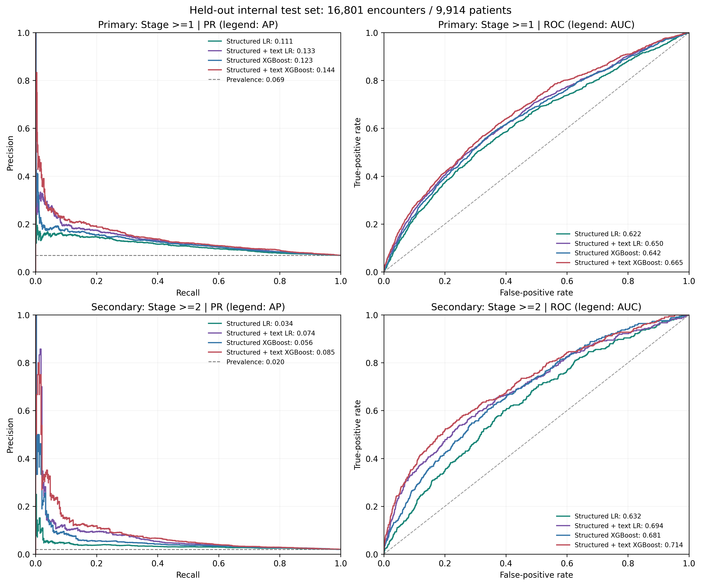
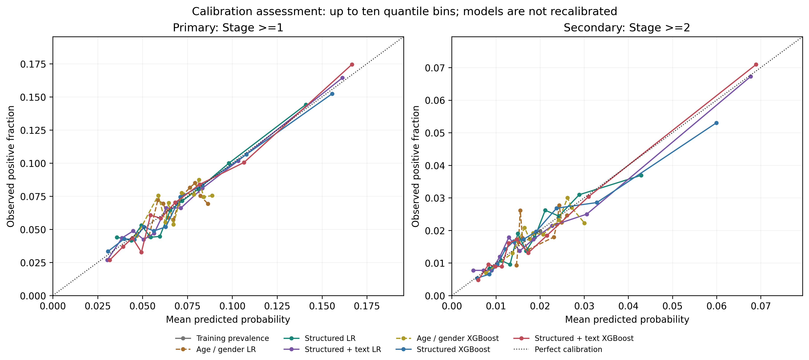
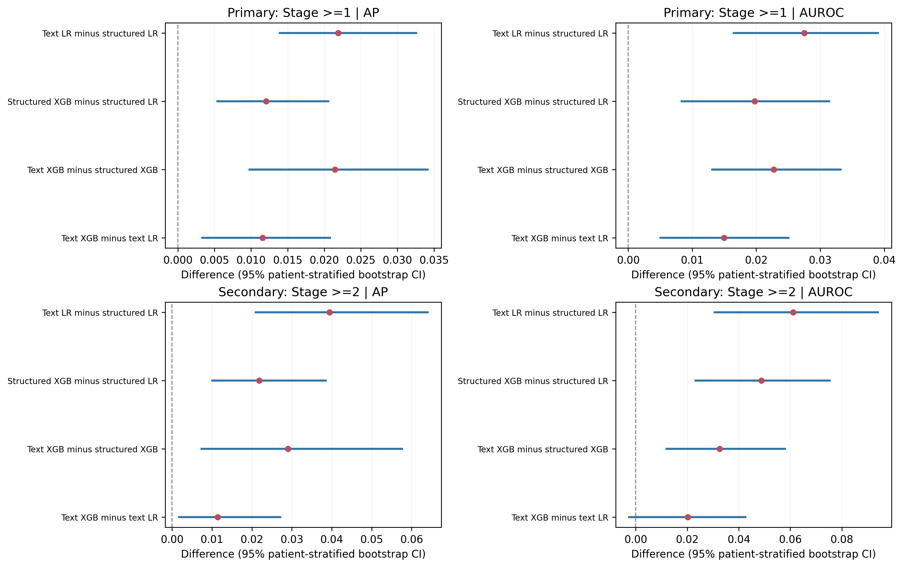
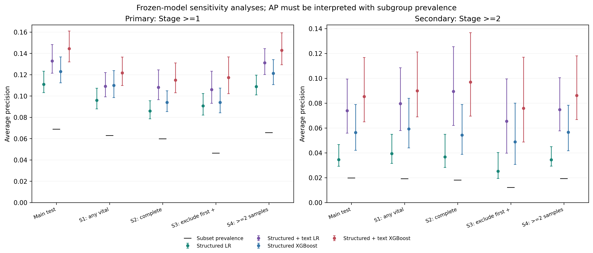

# Person 5 新版评估结果

本次评估包括 Primary（Stage ≥1）和 Secondary（Stage ≥2），每种结局各七个冻结模型。所有区间为 95% CI。

## 分析范围与方法

- 总队列 113,097 次就诊、66,090 名患者；主要阳性 7,866，次要阳性 2,254。
- 测试集 16,801 次就诊、9,914 名患者；主要阳性 1,155，次要阳性 332。Stage 1 在次要结局中记为阴性。
- 预测时点统一为急诊入院时（at ED admission）。
- 各模型分别使用验证集敏感度至少 80% 的最大阈值；主结局阈值沿用旧冻结值，次要结局重新在验证集选择。
- 1,000 次患者级分层 Bootstrap，按患者在评估人群中的最高分期分为 0、1、≥2 三层；每层有放回抽取同样数量患者，保留其所有合格就诊。两种结局和十四个模型共享每次抽样。
- 旧版采用未分层患者 Bootstrap。本版按新要求使用分层抽样，因此 CI 可以变化；旧版文件保持不变，主结局模型、概率与阈值均经过复核。
- 次要模型是在主结局测试结果已经可见之后补充开发。此次冻结早于次要模型测试推理，不能表述为早于所有测试信息接触。
- CI 不包含重新训练和阈值选择的不确定性；未做多重比较调整。常数模型的 NPV、联合校准参数不可定义。

## 主要结局 Stage ≥1

测试阳性率：6.87%。

| 模型 | AP [95% CI] | AUROC [95% CI] | Brier [95% CI] |
| --- | --- | --- | --- |
| Training prevalence | 0.0687 [0.0670, 0.0705] | 0.5000 [0.5000, 0.5000] | 0.0640 [0.0625, 0.0656] |
| Age / gender LR | 0.0739 [0.0699, 0.0790] | 0.5331 [0.5144, 0.5500] | 0.0640 [0.0625, 0.0655] |
| Structured LR | 0.1109 [0.1032, 0.1231] | 0.6224 [0.6055, 0.6397] | 0.0631 [0.0616, 0.0646] |
| Structured + text LR | 0.1328 [0.1213, 0.1483] | 0.6499 [0.6328, 0.6676] | 0.0625 [0.0609, 0.0639] |
| Age / gender XGBoost | 0.0753 [0.0712, 0.0802] | 0.5393 [0.5207, 0.5574] | 0.0639 [0.0625, 0.0655] |
| Structured XGBoost | 0.1229 [0.1123, 0.1366] | 0.6422 [0.6247, 0.6586] | 0.0627 [0.0612, 0.0642] |
| Structured + text XGBoost | 0.1444 [0.1319, 0.1610] | 0.6649 [0.6477, 0.6821] | 0.0621 [0.0605, 0.0636] |

| 模型 | 冻结阈值 | 敏感度 % [CI] | 特异度 % [CI] | PPV % [CI] | NPV % [CI] |
| --- | --- | --- | --- | --- | --- |
| Training prevalence | 0.069881 | 100.0 [100.0, 100.0] | 0.0 [0.0, 0.0] | 6.9 [6.7, 7.1] | NA |
| Age / gender LR | 0.060825 | 81.5 [78.7, 83.9] | 22.8 [21.6, 24.1] | 7.2 [7.0, 7.5] | 94.3 [93.6, 95.0] |
| Structured LR | 0.052481 | 79.1 [76.6, 81.5] | 31.7 [30.8, 32.7] | 7.9 [7.6, 8.2] | 95.4 [94.8, 95.9] |
| Structured + text LR | 0.051644 | 78.4 [75.7, 80.8] | 38.0 [37.1, 38.9] | 8.5 [8.2, 8.9] | 96.0 [95.5, 96.4] |
| Age / gender XGBoost | 0.061636 | 82.3 [79.9, 84.7] | 20.6 [19.6, 21.7] | 7.1 [6.9, 7.4] | 94.0 [93.3, 94.8] |
| Structured XGBoost | 0.049853 | 80.5 [78.1, 83.0] | 34.3 [33.4, 35.2] | 8.3 [8.0, 8.6] | 96.0 [95.5, 96.5] |
| Structured + text XGBoost | 0.050693 | 80.5 [78.1, 82.9] | 38.8 [37.9, 39.8] | 8.9 [8.5, 9.2] | 96.4 [96.0, 96.9] |

配对 AP 差值：

| 模型 A − 模型 B | ΔAP | 95% CI | 区间是否支持 A 更高 |
| --- | --- | --- | --- |
| Structured + text LR − Structured LR | 0.0219 | [0.0138, 0.0327] | 是 |
| Structured XGBoost − Structured LR | 0.0121 | [0.0053, 0.0207] | 是 |
| Structured + text XGBoost − Structured XGBoost | 0.0215 | [0.0097, 0.0343] | 是 |
| Structured + text XGBoost − Structured + text LR | 0.0116 | [0.0032, 0.0209] | 是 |

文本 XGBoost 相比文本 LR：ΔAUROC = 0.0150 [0.0049, 0.0252]；ΔBrier = -0.000369 [-0.000661, -0.000080]（Brier 越低越好）。

文本 XGBoost 在冻结阈值下标记了 62.49% 的测试就诊，敏感度为 80.52%，PPV 为 8.86%。验证集达到 80% 敏感度不保证测试集也达到 80%；这些结果不能直接证明临床部署获益。

## 次要结局 Stage ≥2

测试阳性率：1.98%。

| 模型 | AP [95% CI] | AUROC [95% CI] | Brier [95% CI] |
| --- | --- | --- | --- |
| Training prevalence | 0.0198 [0.0192, 0.0204] | 0.5000 [0.5000, 0.5000] | 0.0194 [0.0189, 0.0199] |
| Age / gender LR | 0.0229 [0.0207, 0.0261] | 0.5531 [0.5215, 0.5844] | 0.0194 [0.0189, 0.0199] |
| Structured LR | 0.0345 [0.0292, 0.0466] | 0.6324 [0.6029, 0.6614] | 0.0193 [0.0188, 0.0199] |
| Structured + text LR | 0.0739 [0.0558, 0.0994] | 0.6936 [0.6637, 0.7260] | 0.0189 [0.0183, 0.0194] |
| Age / gender XGBoost | 0.0243 [0.0221, 0.0276] | 0.5796 [0.5502, 0.6088] | 0.0193 [0.0188, 0.0199] |
| Structured XGBoost | 0.0563 [0.0420, 0.0789] | 0.6812 [0.6507, 0.7086] | 0.0191 [0.0186, 0.0197] |
| Structured + text XGBoost | 0.0853 [0.0650, 0.1166] | 0.7138 [0.6842, 0.7442] | 0.0188 [0.0182, 0.0193] |

| 模型 | 冻结阈值 | 敏感度 % [CI] | 特异度 % [CI] | PPV % [CI] | NPV % [CI] |
| --- | --- | --- | --- | --- | --- |
| Training prevalence | 0.020022 | 100.0 [100.0, 100.0] | 0.0 [0.0, 0.0] | 2.0 [1.9, 2.0] | NA |
| Age / gender LR | 0.015478 | 80.1 [75.6, 84.6] | 24.4 [23.2, 25.6] | 2.1 [2.0, 2.2] | 98.4 [98.0, 98.7] |
| Structured LR | 0.014727 | 82.8 [78.7, 86.7] | 34.2 [33.2, 35.2] | 2.5 [2.3, 2.6] | 99.0 [98.8, 99.2] |
| Structured + text LR | 0.011497 | 84.0 [80.1, 88.2] | 38.5 [37.7, 39.3] | 2.7 [2.5, 2.8] | 99.2 [99.0, 99.4] |
| Age / gender XGBoost | 0.016495 | 86.7 [83.1, 90.1] | 24.1 [23.0, 25.1] | 2.3 [2.1, 2.4] | 98.9 [98.6, 99.2] |
| Structured XGBoost | 0.013151 | 81.6 [77.2, 85.7] | 40.8 [39.9, 41.9] | 2.7 [2.5, 2.9] | 99.1 [98.9, 99.3] |
| Structured + text XGBoost | 0.012985 | 79.8 [75.4, 84.2] | 46.4 [45.5, 47.4] | 2.9 [2.7, 3.1] | 99.1 [98.9, 99.3] |

配对 AP 差值：

| 模型 A − 模型 B | ΔAP | 95% CI | 区间是否支持 A 更高 |
| --- | --- | --- | --- |
| Structured + text LR − Structured LR | 0.0394 | [0.0207, 0.0643] | 是 |
| Structured XGBoost − Structured LR | 0.0218 | [0.0098, 0.0387] | 是 |
| Structured + text XGBoost − Structured XGBoost | 0.0290 | [0.0071, 0.0578] | 是 |
| Structured + text XGBoost − Structured + text LR | 0.0114 | [0.0015, 0.0273] | 是 |

文本 XGBoost 相比文本 LR：ΔAUROC = 0.0202 [-0.0029, 0.0430]；ΔBrier = -0.000086 [-0.000238, 0.000051]（Brier 越低越好）。

这里 AP 的配对区间支持文本 XGBoost 优于文本 LR；但 AUROC、Brier 的差值区间均跨零，还不能确认这两项也有改善。上述区间未作多重比较调整。

文本 XGBoost 在冻结阈值下标记了 54.11% 的测试就诊，敏感度为 79.82%，PPV 为 2.91%。验证集达到 80% 敏感度不保证测试集也达到 80%；这些结果不能直接证明临床部署获益。

## 敏感性分析

S1–S4 沿用 P2 提供的记录标志，模型和阈值不变。S3 按主要结局的首次采样阳性定义；用于次要结局时，也会删除部分 Stage 1（次要阴性）记录。它不是重新定义的“首次采样未达 Stage ≥2”人群。

下表列出文本 XGBoost 的子集结果；完整表包含每种结局的全部七个模型。

### Primary: Stage >=1

| 子集 | 就诊数 | 患者数 | 阳性数 | 阳性率 | AP [95% CI] | AUROC | 敏感度 | PPV |
| --- | --- | --- | --- | --- | --- | --- | --- | --- |
| S1 | 15499 | 9020 | 975 | 6.29% | 0.1216 [0.1098, 0.1365] | 0.6493 | 76.92% | 8.15% |
| S2 | 13355 | 8131 | 797 | 5.97% | 0.1148 [0.1029, 0.1310] | 0.6457 | 74.53% | 7.85% |
| S3 | 16405 | 9844 | 759 | 4.63% | 0.1172 [0.1022, 0.1366] | 0.6866 | 82.87% | 6.17% |
| S4 | 16742 | 9901 | 1096 | 6.55% | 0.1428 [0.1292, 0.1593] | 0.6727 | 81.20% | 8.51% |

### Secondary: Stage >=2

| 子集 | 就诊数 | 患者数 | 阳性数 | 阳性率 | AP [95% CI] | AUROC | 敏感度 | PPV |
| --- | --- | --- | --- | --- | --- | --- | --- | --- |
| S1 | 15499 | 9020 | 296 | 1.91% | 0.0899 [0.0690, 0.1212] | 0.7156 | 77.70% | 2.94% |
| S2 | 13355 | 8131 | 240 | 1.80% | 0.0970 [0.0695, 0.1367] | 0.7186 | 77.92% | 2.88% |
| S3 | 16405 | 9844 | 199 | 1.21% | 0.0759 [0.0487, 0.1169] | 0.7160 | 81.41% | 1.83% |
| S4 | 16742 | 9901 | 321 | 1.92% | 0.0862 [0.0667, 0.1180] | 0.7236 | 81.31% | 2.88% |

S1：至少一项生命体征非缺失；S2：完全病例；S3：排除主结局首次采样已阳性；S4：至少两次采样。

子集结果见 [完整敏感性表](outputs/tables/sensitivity_metrics.csv) 和 [全部配对区间](outputs/tables/all_paired_differences.csv)。不同子集、不同结局的 AP 不能脱离各自阳性率直接比较；不能仅凭点估计排序，断言某个模型在每个子集中均更好。

## 图与数据

- [两种结局完整对比表](outputs/tables/combined_model_comparison.csv)
- [验证集阈值](outputs/tables/validation_thresholds.csv)
- [主测试集配对差值](outputs/tables/test_paired_differences.csv)
- [运行说明与限制](README.md)
